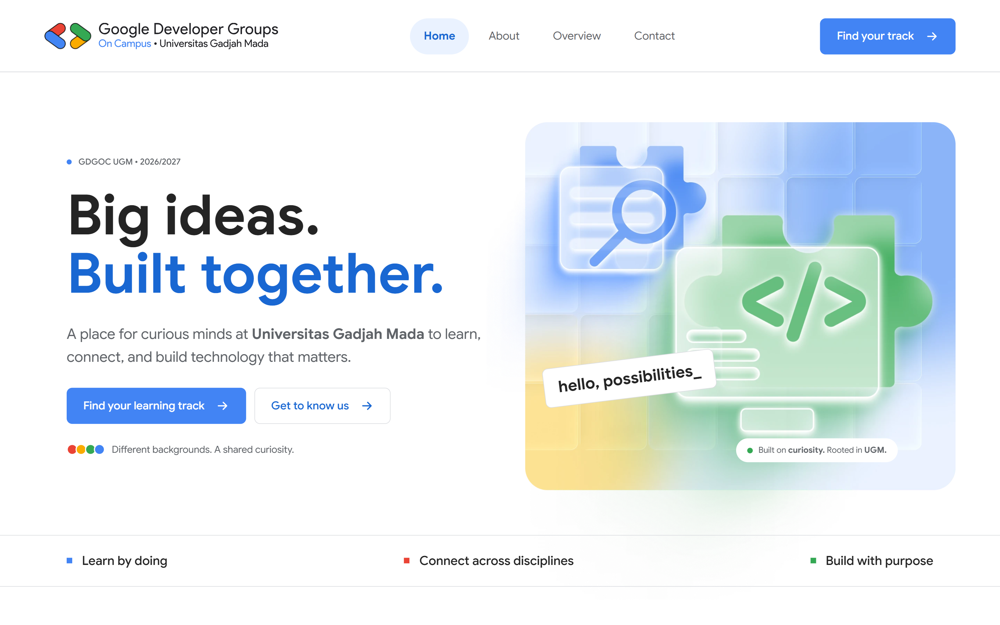
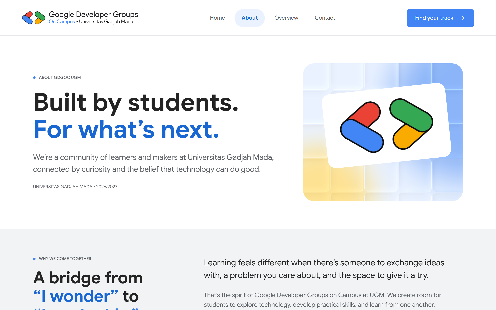
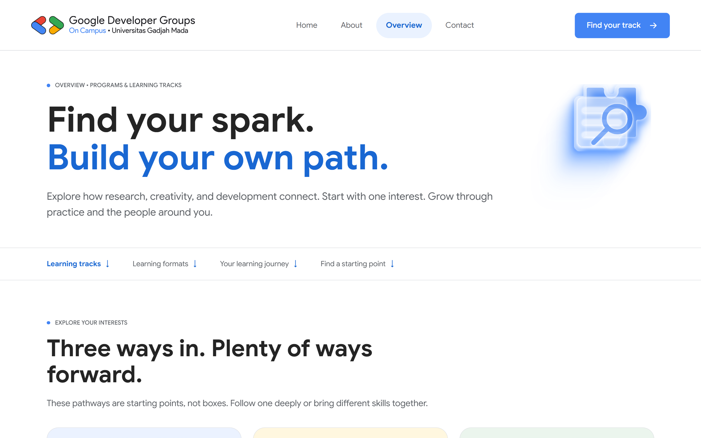
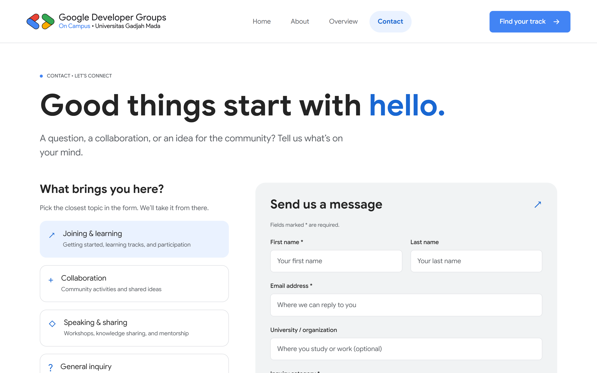
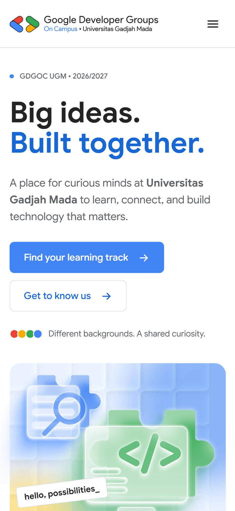
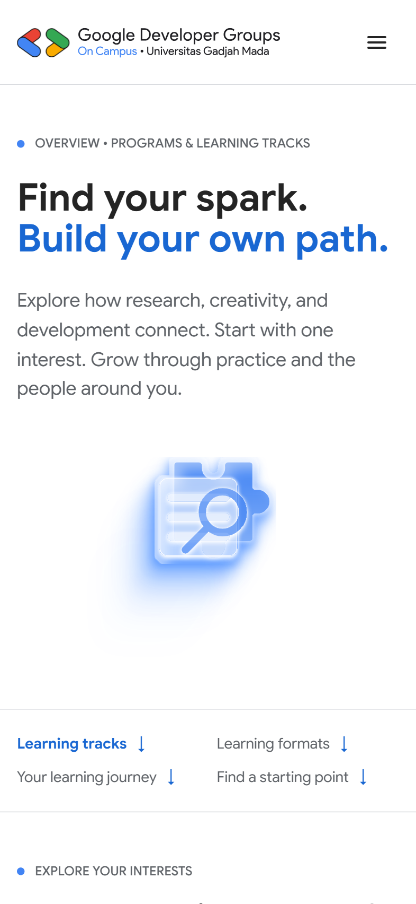
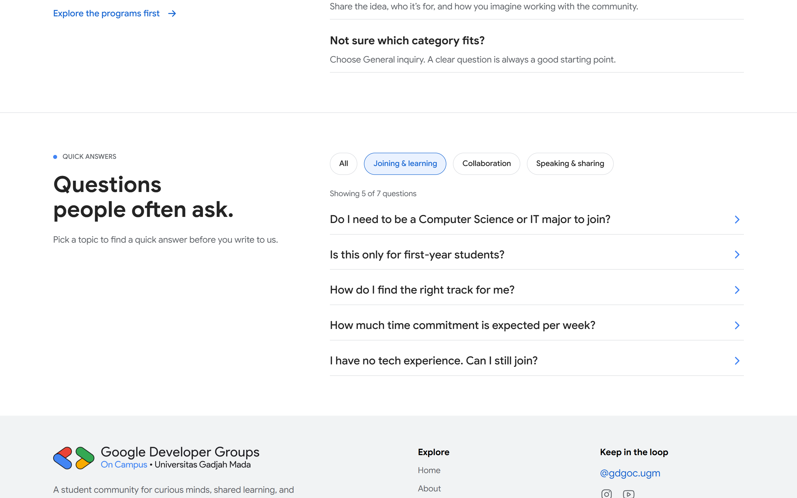
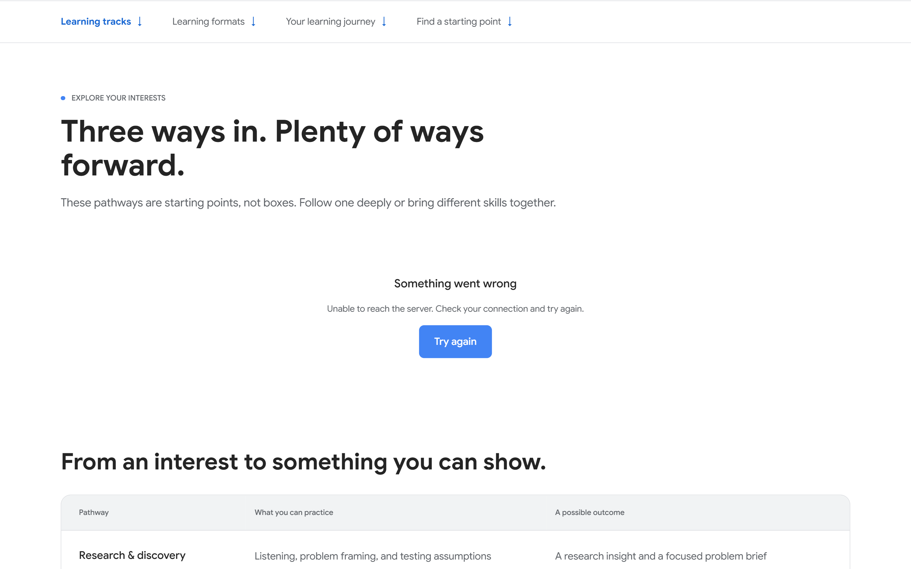
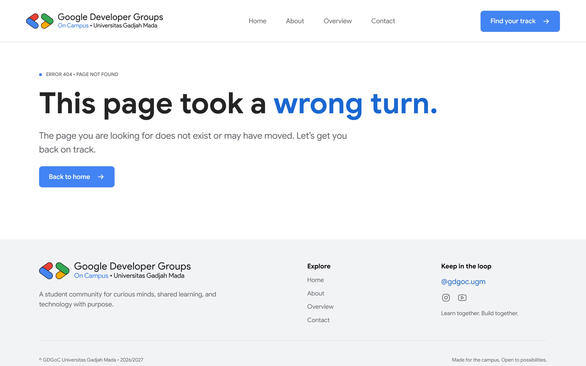

# Google Developer Groups on Campus UGM

Ini website komunitas Google Developer Groups on Campus Universitas Gadjah Mada yang saya buat untuk technical assignment Hacker Frontend, Open Recruitment GDGoC UGM 2026/2027. Ada empat halaman (Home, About, Overview, Contact) yang saya buat dari desain Figma pakai React dan Tailwind CSS, dengan data dari REST API publik.

## Link penting

| | |
|---|---|
| Live demo | https://gdgoc-fe-assignment.vercel.app |
| Video presentasi | [Link Google Drive](https://drive.google.com/drive/folders/1uHdF9AkLwzstOkWy_ReQGl48r_ddR04V?usp=drive_link), video langsung di [YouTube](https://youtu.be/1CoNVQEgTuA) |
| Repository | https://github.com/rafa1606/gdgoc-fe-assignment |
| API | https://gdgoc-ugm-api.vercel.app/api |

## Screenshots

Desktop (1440 px)

| Home | About |
|---|---|
|  |  |
| Overview | Contact |
|  |  |

Mobile (393 px)

| Home | Overview |
|---|---|
|  |  |

State lain

| FAQ dengan filter | Error (Try again) |
|---|---|
|  |  |
| 404 | |
|  | |

## Fitur

- Empat halaman responsif, dari layar 320 px sampai desktop lebar.
- Data diambil dari API, lengkap dengan state loading, error (ada tombol coba lagi), dan kosong.
- Error boundary untuk error yang muncul saat render.
- FAQ di halaman Contact bisa difilter per kategori. Filternya tersimpan di URL, jadi tidak hilang setelah reload dan bisa dibagikan lewat link.
- Form kontak dengan validasi dan pesan sukses. Pengirimannya simulasi karena API cuma punya endpoint GET.
- Tombol di kartu format (Overview) membuka Contact dengan kategori yang sudah terpilih.
- Menu mobile yang buka tutupnya dianimasikan.
- Gambar dan data halaman lain dimuat di belakang layar. Judul tab beda di tiap halaman, dan ada halaman 404.
- Animasi mengikuti pengaturan reduced motion di perangkat pengguna.

## Tech stack

- React 19 dan TypeScript 6 (mode strict)
- Vite 8
- Tailwind CSS 4, design token-nya di `@theme` (`src/index.css`)
- React Router 8
- ESLint 10 dengan typescript-eslint dan eslint-plugin-react-hooks
- Font Google Sans lewat `@fontsource/google-sans`

## Cara menjalankan

Butuh Node.js 20.19 atau lebih baru (atau 22.12+) dan npm.

```bash
git clone https://github.com/rafa1606/gdgoc-fe-assignment.git
cd gdgoc-fe-assignment
npm install
npm run dev
```

Buka http://localhost:5173. Tidak perlu file `.env`, alamat API ada di `src/api/client.ts`.

| Script | Fungsi |
|---|---|
| `npm run dev` | Menjalankan dev server |
| `npm run build` | Cek tipe dengan `tsc -b`, lalu build produksi ke `dist` |
| `npm run preview` | Menjalankan hasil build secara lokal |
| `npm run lint` | Menjalankan ESLint |

## Struktur proyek

```
src/
├── api/          client fetch, daftar endpoint, prefetch, simulasi kirim pesan
├── assets/       gambar dan ikon
├── components/
│   ├── about/    bagian halaman About
│   ├── contact/  form, kategori inquiry, FAQ, validasi
│   ├── home/     bagian halaman Home
│   ├── layout/   Layout, Navbar, Footer
│   ├── overview/ track, format, journey
│   └── ui/       komponen yang dipakai ulang (tombol, state, error boundary)
├── data/         konten statis dari desain
├── hooks/        useFetch, usePageTitle
├── pages/        satu file per halaman
├── types/        tipe respons API
└── utils/        helper kecil (teks, preload gambar)
```

## Arsitektur komponen

- Folder `src/pages` isinya tipis. Tiap halaman cuma menyusun section, misalnya `Overview` memanggil `OverviewIntro`, `TracksSection`, `FormatsSection`, dan seterusnya.
- Section ada di `src/components/<halaman>`. Section yang butuh data memanggil `useFetch` sendiri, jadi tiap bagian punya loading dan error masing-masing. Kalau satu endpoint gagal, bagian lain tetap tampil.
- Komponen yang dipakai ulang ada di `src/components/ui`: `ButtonLink`, `SectionLabel`, `LoadingState`, `ErrorState`, `EmptyState`, dan `ErrorBoundary`.
- `Layout` (`Navbar`, `Footer`, dan `<Outlet />`) membungkus semua halaman. Data navigasi dan statistik di sana juga dari API, dengan menu cadangan kalau request gagal.

## State management

Saya tidak pakai library state tambahan. State dibagi menurut jenisnya.

Server state diurus hook `useFetch` (`src/hooks/useFetch.ts`). Hasilnya union `loading | error | success`, request bisa dibatalkan dengan `AbortController`, dan ada fungsi `retry`. Hasil request disimpan di cache dalam memori selama sesi, dan setelah halaman selesai dimuat, data halaman lain diambil duluan (`src/api/prefetch.ts`). Jadi waktu pindah halaman, data langsung tampil lalu diperbarui diam-diam di belakang. Kalau pembaruannya gagal, data lama tetap dipakai.

State di URL lewat `useSearchParams`: `?track=` untuk track yang disorot di Overview, `?category=` untuk kategori inquiry, dan `?faq=` untuk filter FAQ. Parameter yang tidak dikenal diabaikan, dan parameter lain tidak ikut terhapus waktu salah satunya berubah.

State lokal lewat `useState`: menu mobile, FAQ yang terbuka, isi form, dan error form.

Data yang dipakai beberapa komponen diambil sekali di halamannya lalu dikirim lewat props. Contohnya halaman Contact: kategori inquiry diambil satu kali, lalu dipakai untuk pilihan kategori, form, tips, dan label filter FAQ.

## Konsumsi API

Base URL: `https://gdgoc-ugm-api.vercel.app/api`. Semua request lewat `request<T>()` di `src/api/client.ts`. Fungsi ini melempar `ApiError` dengan pesan yang bisa langsung ditampilkan ke pengguna.

| Endpoint | Dipakai di |
|---|---|
| `/tracks` | Overview |
| `/formats` | Overview |
| `/journey` | Overview |
| `/values` | About |
| `/roles` | About |
| `/inquiry-categories` | Contact (kategori, form, tips, label filter FAQ) |
| `/faqs` | Contact |
| `/navigation` | Navbar dan Footer |
| `/stats` | Footer |

Endpoint `/tracks/:id` tidak dipakai karena `/tracks` sudah mengembalikan semua field tiap track.

Penanganan state data:

- Loading: `LoadingState`. Spinner baru muncul kalau request lebih dari 0,4 detik, supaya tidak berkedip waktu jaringan cepat.
- Error: `ErrorState` dengan pesan dan tombol "Try again".
- Kosong: `EmptyState` kalau API mengembalikan array kosong.
- Error render: `ErrorBoundary` di `Layout` menangkap error yang tidak terduga, misalnya bentuk data yang beda dari yang diharapkan, supaya halaman tidak jadi kosong.

## Additional Challenges

### Advanced frontend logic

- Filter FAQ per kategori di sisi client, dengan state di URL (`?faq=`). Kalau halaman dibuka lewat link yang membawa filter, tampilan langsung scroll ke bagian FAQ.
- Track yang disorot dan kategori inquiry yang dipilih juga tersimpan di URL.
- Langkah journey diurutkan di sisi client berdasarkan field `step`.
- Urutan kartu format disusun mengikuti desain.
- Pagination tidak saya buat karena datanya kecil. Endpoint paling banyak isinya 7 item (FAQ).

### Code quality

- TypeScript strict, ditambah `noUnusedLocals`, `noUnusedParameters`, dan `verbatimModuleSyntax`. Script `build` menjalankan `tsc -b` sebelum Vite.
- ESLint flat config dengan typescript-eslint dan aturan react-hooks. `npm run lint` bersih.
- Commit memakai format `feat`, `fix`, `style`, `chore`, `refactor`, `perf`, dan `docs`, satu commit untuk satu perubahan.

### Data understanding

- Filter FAQ memakai kategori dari data `/faqs`, labelnya diambil dari `/inquiry-categories`. Jadi dua endpoint digabung.
- Dua dari tiga tips di bawah form Contact diambil dari field `guidance` (kategori `joining-learning` dan `collaboration`). Tip ketiga teks statis dari desain, isinya sama dengan guidance `speaking-sharing`.
- Tombol di kartu format (`join-a-group`, `start-a-circle`, `see-upcoming`, `propose-a-session`) dipetakan ke kategori inquiry yang sesuai, lalu membuka `/contact?category=...`.
- Kartu track yang dibuka lewat `?track=` diberi sorotan dan `aria-current`.
- Ikon dan ilustrasi memakai aset dari Figma. Emoji dari API cuma jadi cadangan di kartu values dan format, kalau ada item baru yang belum punya ikon.

## Keputusan desain

- Home memakai konten statis dari desain (`src/data/homeContent.ts`). Teks di Overview ikut data API, jadi untuk track yang sama, kalimat di Home dan Overview agak berbeda.
- Form kontak disimulasikan (`src/api/contact.ts`) karena API tidak punya endpoint POST. Fungsinya menunggu sebentar lalu mengembalikan pesan yang sama.
- Dropdown kategori memakai `<select>` bawaan browser. Tampilan modernnya (`appearance: base-select`) cuma aktif di browser yang mendukung lewat `@supports`, browser lain memakai tampilan standar.
- Efek hover (kartu terangkat) hanya untuk kartu yang punya tautan dan hanya di perangkat yang punya hover. Semua animasi memakai `motion-safe:`.
- Pindah halaman mengembalikan scroll ke atas tanpa animasi (`behavior: 'instant'`, soalnya situs ini pakai smooth scroll), lalu memutar animasi masuk yang singkat.
- Menu mobile dianimasikan dengan `grid-template-rows` dari `0fr` ke `1fr`, karena tinggi `auto` tidak bisa dianimasikan. Menu yang tertutup diberi `inert` supaya tidak bisa difokus keyboard.
- Warna garis di kartu values memakai token desain, bukan warna dari API, karena kuning di API beda dari Figma.
- Preload gambar (`src/utils/preloadImages.ts`) dan data halaman lain (`src/api/prefetch.ts`) jalan setelah halaman selesai dimuat.
- Aksesibilitas: field form punya `aria-invalid` dan `aria-describedby`, fokus pindah ke field pertama yang error, kartu kategori dan chip filter memakai `aria-pressed`, tombol FAQ dan menu memakai `aria-expanded`.

## Perbedaan dari desain Figma

Selisih kecil yang saya temukan waktu mengukur hasil build dengan desain:

- Tinggi halaman Home 22 px lebih panjang dari Figma, karena footer kartu track saya sejajarkan di bagian bawah.
- Tombol di hero 2 sampai 3,5 px lebih sempit.
- Tabel learning outcomes selisih sekitar 5 px.
- Teks track, format, dan journey di Overview mengikuti data API, jadi beda dari teks di Figma.
- Bagian FAQ di halaman Contact saya tambahkan dari data `/faqs`. Bagian ini tidak ada di Figma.

## Deployment

Dideploy di Vercel dari branch `main`. Vercel mengenali Vite otomatis (build `npm run build`, output `dist`). `vercel.json` mengarahkan semua path ke `index.html`, jadi membuka `/contact` langsung tidak menghasilkan 404.

## Penulis

Dibuat oleh [@rafa1606](https://github.com/rafa1606).